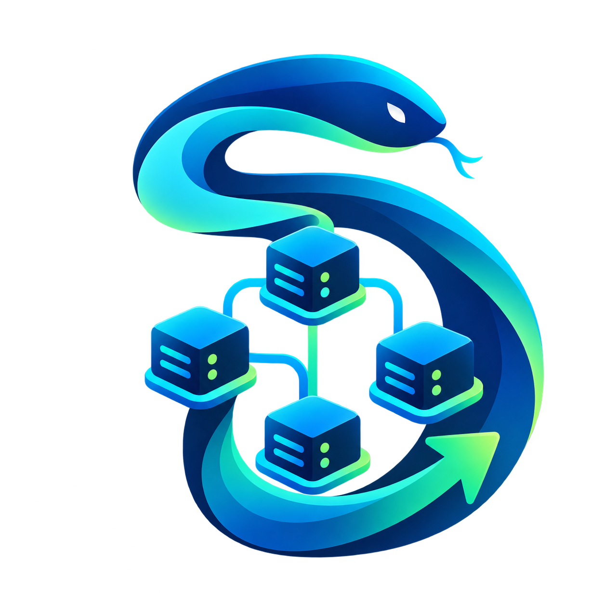

# Snakemake Executor Plugin for Huawei Donau Scheduler

<p align="center">
  
</p>


[中文文档 (Chinese Documentation)](docs/README_zh.md)

This is a Snakemake executor plugin designed specifically for the **Huawei Donau** High Performance Computing (HPC) scheduler. It enables Snakemake to interact directly with the Donau scheduling system, handling job submission, status monitoring, and resource management automatically.

## ✨ Key Features

- **Native Adaptation**: deeply integrated with `dsub`, `djob`, and `dkill` commands.
- **Smart Resource Mapping**: Automatically translates Snakemake resources (`threads`, `mem_mb`, `runtime`, `npu`/`gpu`, `account`, `mpi`) into Donau resource request parameters (e.g., `-R cpu=X,mem=YMB`, `-T`, `-A`, `--mpi`).
- **Robust Status Checking**: Implements a batch dual-query mechanism ("Active Queue" + "History Database") to prevent false status judgments caused by jobs finishing instantly or rapid scheduler cleanup. No matter how many jobs are active, only 1–2 `djob` calls are needed per poll.
- **Failure Diagnostics**: When a job fails, the executor automatically fetches `djob -ll` details (exit message, exit code, peak memory, walltime) and appends an actionable hint (e.g. "increase mem_mb") to the error report.
- **Identifiable Job Names**: Job names embed rule name, wildcards, Snakemake job ID, and a run tag (e.g. `smk_call_variant_sample-chr1_1234_a1b2c3`), so you can tell jobs apart directly in `djob` listings.
- **Heartbeat Logs**: The polling loop emits a heartbeat line every 10 minutes even when nothing changes, so "jobs running normally" and "main process stuck" are distinguishable in the log.
- **Seamless Logging**: Integrated with Snakemake's global logging system. Automatically adapts to `--logger rich-loguru` for high-quality terminal output while maintaining a plain-text, grep-friendly local debug log.
- **Safe Cancellation**: Supports batch, forced, and non-interactive job cancellation via Ctrl+C, with every `dkill` recorded in the log.
- **Async Performance**: Utilizes `asyncio` for non-blocking status polling, suitable for large-scale workflows.

## 🛠️ Installation

Ensure you have Python 3.8+ and Snakemake 9.0+ installed.

### pip Installation (Preferred)

This is the easiest way to install the plugin directly from PyPI:

```bash
pip install snakemake-executor-plugin-donau
```

### Source Installation (Development)

Since Snakemake is often used with Conda & Mamba, it is recommended to install the plugin via pip after activating your Snakemake environment:

```bash
git clone https://github.com/xsx123123/snakemake_executor_donau.git
cd snakemake_executor_donau
pip install -e .
```

## 🚀 Quick Start

### 1. Basic Usage

Once installed, use the `--executor donau` argument to enable this plugin:

```bash
snakemake --executor donau --jobs 100
```

## 🧪 Testing

A test environment is provided in the `Test/` directory. You can verify the plugin's functionality using the following command:

```bash
# Run from the project root
snakemake --snakefile Test/snakefile --executor donau --jobs 10 --latency-wait 60
```

- `--jobs 10`: Limits the maximum number of concurrent jobs to 10.
- `--latency-wait 60`: Wait up to 60 seconds for output files to appear on the filesystem (recommended for HPC shared filesystems).

### 2. Snakefile Example

Define resources in your `Snakefile`, and the plugin will automatically convert them to scheduler parameters:

```python
rule complex_task:
    input:
        "data/raw.txt"
    output:
        "results/final.txt"
    # 1. Set Job Priority (Maps to dsub -p)
    priority: 9999
    # 2. Set Resources
    resources:
        queue = "fat_node",       # -q fat_node
        mem_mb = 8192,            # -R mem=8192MB
        npu = 1,                  # -R npu=1 (AI/NPU queues)
        runtime = 120,            # -T 7200 (120 min -> seconds)
        nodes = 2,                # -N 2 (Replicas/Nodes)
        exclusive = True,         # -x (Exclusive mode)
        tag = "group=bio",        # --tag group=bio
        account = "proj_01",      # -A proj_01
        mpi = "openmpi",          # --mpi openmpi
        dsub_extra = "--env ALL"  # any extra dsub flags (escape hatch)
    threads: 8                    # -R cpu=8
    shell:
        "echo 'Running on Donau' > {output}"
```

## ⚙️ Resource Mapping Details

The plugin maps Snakemake resource definitions to `dsub` parameters as follows:

| Snakemake Keyword | Meaning | Donau Parameter | Notes |
| :--- | :--- | :--- | :--- |
| `threads` | CPU Cores | `-R cpu=<threads>` | Defaults to 1 |
| `priority` | Priority | `-p <int>` | Maps Snakemake priority (1-9999) |
| `resources.mem_mb` | Memory (MB) | `-R mem=<mem_mb>MB` | Defaults to 1024MB |
| `resources.queue` | Queue Name | `-q <queue>` | `partition` is also supported |
| `resources.npu` | NPU Cards | `-R ...,npu=<n>` | Combined with cpu/mem in one `-R` |
| `resources.gpu` | GPU Cards | `-R ...,gpu=<n>` | Combined with cpu/mem in one `-R` |
| `resources.runtime` | Runtime (min) | `-T <seconds>` | Converted to seconds. `time_min` is also supported |
| `resources.nodes` | Replicas/Nodes | `-N <count>` | `replica` is also supported |
| `resources.exclusive` | Exclusive | `-x job` | Set to `True` or `1` to enable |
| `resources.tag` | Custom Tag | `--tag <string>` | e.g. "key=value" |
| `resources.account` | Account | `-A <account>` | For billing/permissions |
| `resources.mpi` | MPI Type | `--mpi <type>` | e.g., `openmpi`, `intelmpi` |
| `resources.dsub_extra` | Extra dsub Args | appended verbatim | Escape hatch for unmapped flags; overrides the plugin-level `submit_extra_args` setting |

## 🔧 Executor Settings

The following plugin-level options are available on the command line (each takes precedence over or complements the per-rule resources):

| Flag | Default | Description |
| :--- | :--- | :--- |
| `--donau-any-arch` | `true` | Pass `-aa` together with `-q`. Required by Donau clusters, otherwise jobs stay PENDING forever. |
| `--donau-default-queue` | none | Default `-q` for jobs that do not define a `queue`/`partition` resource. |
| `--donau-heartbeat-interval` | `600` | Seconds between heartbeat log lines while polling. Set to `0` to disable. |
| `--donau-log-dir` | workdir | Directory where `donau_executor.log` is written. |
| `--donau-submit-extra-args` | none | Extra arguments appended to every `dsub` command, e.g. `--donau-submit-extra-args "--env ALL"`. |

Example:

```bash
snakemake --executor donau --jobs 100 \
    --donau-default-queue x86 \
    --donau-heartbeat-interval 300
```

## 📝 Logging & Troubleshooting

### 1. Unified Terminal Output
The plugin automatically inherits Snakemake's global logger. If you use `--logger rich-loguru`, plugin logs (submission, success, etc.) will be rendered with the same high-quality formatting.

### 2. Local Debug Log (Workdir)
For detailed troubleshooting, the executor writes a persistent log to your working directory:
- **Path**: Created in the workflow's current working directory (respects Snakefile `workdir` or `--directory`), rotated at 50 MB with 7-day retention.
- **Content**: Precise timestamps, source code location (module:function:line), UUIDs, full shell commands (`dsub`), and raw scheduler responses.
- **Plain text**: No ANSI color codes, so you can `grep`/`awk` it directly. Meaningless empty `None` lines from Snakemake's logging thread are filtered out.

### 3. Heartbeat Lines
While jobs are running, the log would otherwise be silent (a successful poll produces no output). Every 10 minutes the executor prints one line like:

```
[heartbeat] 140 job(s) active, queried 140 state(s): RUNNING=132, PENDING=8
```

If this line keeps appearing, the polling loop is healthy and jobs are simply still running. If the log goes silent **and** heartbeats stop, the main process is likely stuck — capture a stack with `py-spy dump --pid <snakemake_pid>` to diagnose.

### 4. Failure Diagnostics
When a job reaches a failed state, the executor automatically runs `djob -ll <id>` and includes the result in the error report, e.g.:

```
Donau job 40587533 failed with state FAILED.
Donau job details (djob -ll):
  jobExitCode: 1
  systemExitCode: 10001
  exitMessage: Job command execution failed, errCode: 1
  totalMaxMem: 0
  jobWallclockDuration: 13
  execNodes: agent-X86-56
Hint: job command exited with code 1, check the job log for details
```

This usually saves you a manual `djob -ll` lookup. Typical hints: walltime limit → increase `resources.runtime`; memory limit (`errCode: 143`) → increase `resources.mem_mb`.

### 5. Job Standard Output (Per Rule)
The stdout and stderr of each specific job are redirected to:
- **Path**: `.snakemake/donau_logs/rule_<name>/<wildcards>/<jobid>.log`

## 🔧 Underlying Logic

This plugin relies on the following Donau commands (ensure they are available in `$PATH`):

1.  **Job Submission (`dsub`)**
    *   Uses `-n` to specify the job name (embeds rule, wildcards, job ID, and run tag; truncated to fit scheduler limits).
    *   Uses `-oo` to capture both stdout and stderr.
    *   Uses `--cwd` to lock the working directory.
    *   Includes automatic retry logic for network stability.

2.  **Status Query (`djob`)**
    *   Command: `djob -o "jobId state" --no-header <jobid...>` — a **single batch query** covering all active jobs (active queue), falling back to `djob -D -o "jobId state" --no-header <missing_ids...>` (completed/history database) for IDs absent from the active queue.
    *   Logic: One round of polling costs at most 2 `djob` invocations regardless of concurrency. Jobs missing from both queries stay active for the next poll and are never misreported as successful.

3.  **Job Cancellation (`dkill`)**
    *   Command: `dkill -y --force <id_list>`
    *   Logic: Uses `-y` to skip interactive confirmation and `--force` to ensure jobs are thoroughly cleaned up. Both the request and the result are logged.

## 📂 Project Structure

Following the official Snakemake plugin conventions:

```text
snakemake_executor_donau/
├── pyproject.toml                     # Poetry configuration (deps & entry points)
├── README.md                          # Documentation (English)
├── docs/
│   └── README_zh.md                   # Documentation (Chinese)
└── snakemake_executor_plugin_donau/   # Core code directory (must follow strict naming)
    ├── __init__.py                    # Plugin entry point
    ├── executor.py                    # Core logic (submit/query/cancel)
    └── logging.py                     # Logging configuration
```

## 📦 Development & Building Guide

If you intend to develop your own Snakemake plugin or contribute to this project, please adhere to the following standards:

### 1. Naming Convention (Strict)
Snakemake's plugin discovery mechanism enforces strict naming:
*   **Code Directory**: Must be named `snakemake_executor_plugin_<name>` (e.g., `snakemake_executor_plugin_donau`).
*   **Project Name (PyPI)**: Recommended to be `snakemake-executor-plugin-<name>`.

### 2. Configuration (pyproject.toml)
This project uses the **Poetry** standard format, which is recommended by Snakemake. The key configuration is:

```toml
[tool.poetry.plugins."snakemake.executors"]
donau = "snakemake_executor_plugin_donau:Executor"
```
This line tells Snakemake: "When the user specifies `--executor donau`, load the `Executor` class from the `snakemake_executor_plugin_donau` module."

### 3. Local Development Flow
1.  **Clone the Repository**:
    ```bash
    git clone https://github.com/xsx123123/snakemake_executor_donau.git
    cd snakemake_executor_donau
    ```
2.  **Install in Editable Mode**:
    Within your Snakemake environment, run:
    ```bash
    pip install -e .
    ```
    *Note: You do not need to install `poetry` explicitly; `pip` handles the build via `pyproject.toml`.*
3.  **Verify**:
    ```bash
    snakemake --help | grep donau
    ```
    If `donau` appears in the output, the plugin is successfully registered.

## ⚠️ Notes

*   **Interruption & Restart**: Sidecar mode journals accepted submissions and
    reconciles surviving jobs on restart; keep the journal and follow the
    [recovery guide](docs/sidecar.md). The following manual procedure applies to
    legacy runs without a journal. When Snakemake is terminated with Ctrl+C, it automatically cancels all submitted Donau jobs via `dkill` (look for `Cancelling N Donau job(s)` in the log). However, if the main process is killed with `kill -9` or the terminal is closed, **jobs are NOT cancelled** and become orphans. Before restarting the same workflow, verify no old `smk_*` jobs are still alive:
    ```bash
    djob -u $USER -o "jobId name state" | grep smk_
    ```
    Leftover jobs from an old run and new jobs from the restarted run may write the same output files concurrently.
*   **Large Workflow Tuning**: For workflows with hundreds of concurrent jobs, consider raising Snakemake's polling interval to further reduce scheduler load (the plugin already batches all status queries into at most 2 `djob` calls per round):
    ```bash
    snakemake --executor donau --jobs 500 --seconds-between-status-checks 30
    ```
*   **Runtime Configuration**: It is **not recommended** to set `runtime` or `time_min` in your `resources` unless strictly necessary. Setting a hard limit might cause the scheduler to kill long-running jobs prematurely, or if misconfigured, might affect Snakemake's status polling behavior (though the plugin handles timeouts gracefully). Let the scheduler determine the default walltime when possible.
*   **Queue Names**: Ensure the `queue` specified in your Snakefile actually exists in your cluster.
*   **Memory Units**: The plugin enforces `MB` as the unit when interacting with the scheduler.
*   **Shared Filesystem**: The default configuration assumes all compute nodes share a filesystem. If not, storage plugins need to be configured.


### Bounded submission concurrency

`--donau-submit-concurrency 16` controls simultaneous `dsub` processes (1–64).
Use `1` for serial submission. Requests are built and submission callbacks run
on the Snakemake scheduler thread; only CLI work runs in the pool. The pool
is drained before shutdown. Single-job `run_job` calls remain synchronous.
`--donau-any-arch true|false` explicitly controls `-aa` (default `true`).

For reproducible local synthetic measurements, see [baseline.md](baseline.md).
`SAMPLES=1000 snakemake --snakefile Test/snakefile --executor donau --jobs 100`
selects the stress workflow size; its memory, I/O and random failure workloads
are retained. See [sidecar configuration and recovery](docs/sidecar.md) for the
Rust proxy, journal recovery, mock tests, binary wheel build and rollback.
Real Donau cluster validation remains pending.

For cluster validation, use [Test/run_cluster_tests.py](Test/run_cluster_tests.py)
and the [cluster testing guide](Test/集群测试说明.md). It isolates outputs,
collects CLI timings and independent scheduler truth, and supports comparison,
controlled main-process crashes and recovery without deleting the journal.
