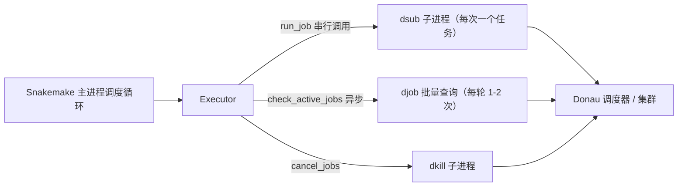
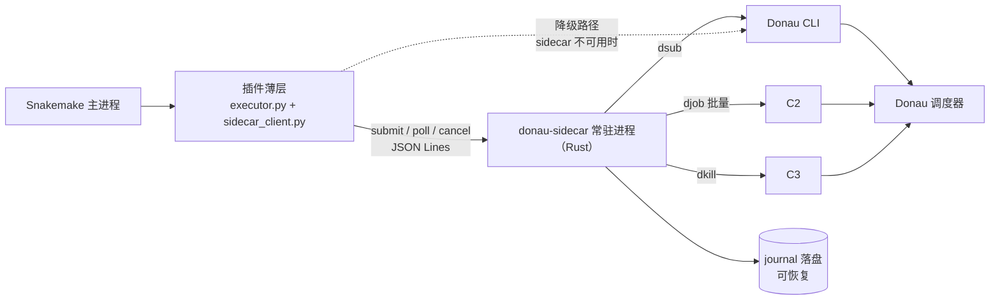
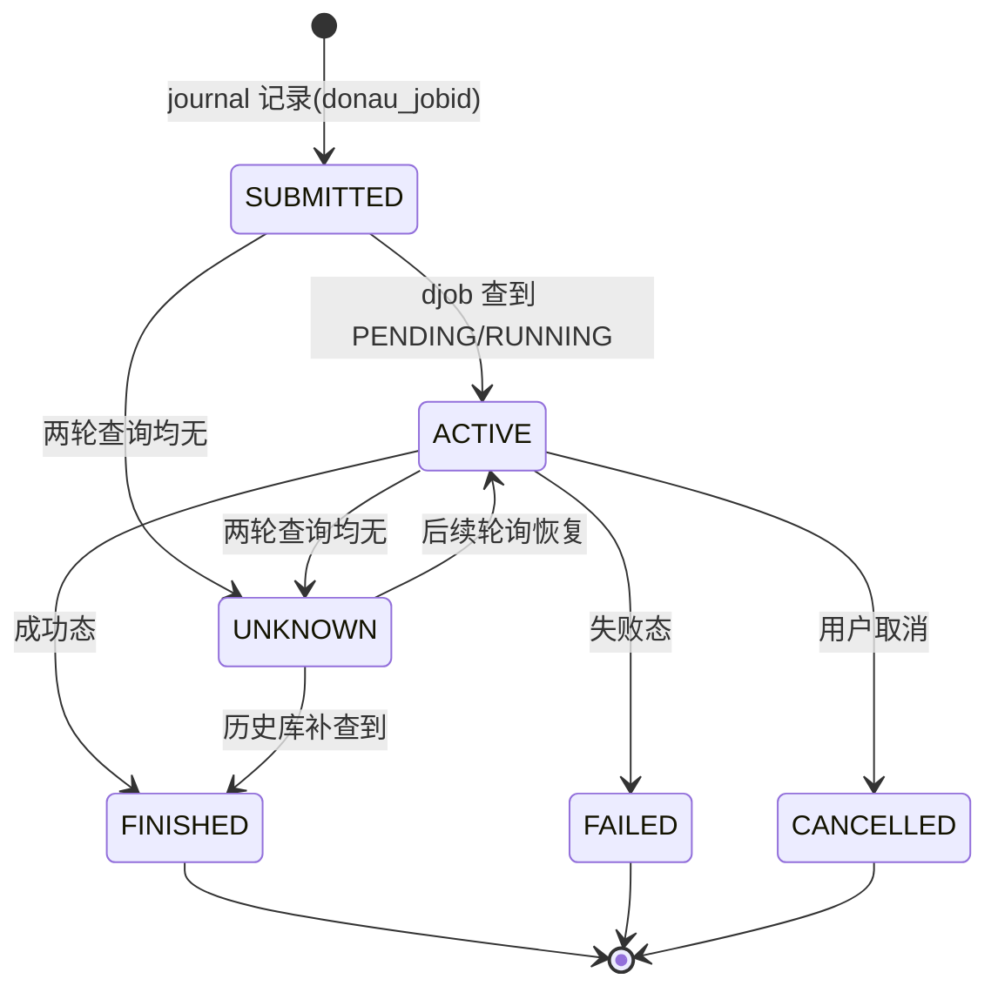

# Snakemake Donau 执行器性能优化方案

- 关联仓库：https://github.com/xsx123123/snakemake_executor_donau
- 文档版本：v1.0（2026-10-18）
- 适用范围：大规模（千级 ~ 十万级任务）集群调度场景下，本插件的提交吞吐、轮询开销、崩溃恢复能力优化
- 配套文档：《snakemake_executor_donau_优化提示词.md》（可直接下发给 AI 编码助手的提示词包）

---

## 1. 背景与目标

### 1.1 背景

`snakemake_executor_donau` 是面向华为 Donau HPC 调度器的 Snakemake 执行器插件（约 519 行 Python）。它把 Snakemake 的资源语义（`threads / mem_mb / npu / gpu / runtime / queue / nodes / exclusive / account / mpi / tag`）映射为 `dsub` 参数，并负责 `djob` 状态轮询与 `dkill` 取消。

在任务量很大的集群场景下，用户感知的瓶颈主要有三类：

1. **提交慢**：每个任务一次 `dsub` 子进程调用，且**串行**执行；
2. **崩溃不可续跑**：主进程 `kill -9` 后作业变孤儿、重启后状态全丢；
3. **调度器负载**：轮询频率与批量化程度直接影响 Donau 侧压力。

### 1.2 优化目标（可量化）

| 编号 | 目标 | 量化指标 | 优先级 |
|---|---|---|---|
| G1 | 提升提交吞吐 | 万级任务的提交阶段耗时相对基线（串行）降低一个数量级以上，或达到 Donau API/CLI 吞吐上限 | P0 |
| G2 | 控制轮询开销 | 任意并发度下每轮轮询的 `djob` 调用保持在 1–2 次；轮询不成为 CPU 热点 | P0 |
| G3 | 崩溃可恢复 | 主进程被杀后，重启可识别存量作业、不双写、不误判 | P1 |
| G4 | 保持兼容 | Snakemake 插件接口契约、`dsub/djob/dkill` 资源映射语义、现有命令行参数全部不变 | 硬约束 |
| G5 | 状态零误判 | 压测全程无「假成功 / 假失败」（以 `djob` 真值为准） | 硬约束 |

### 1.3 非目标（明确不做）

- 不重写 Snakemake 核心调度循环（DAG 解析、文件系统检查）——它在大规模下也有开销，但不在本插件职责内；
- 不改变 Donau 侧调度策略、队列配置；
- 不改变资源映射语义与命令行参数（`-R/-q/-T/-N/-A/--mpi/-x/--tag` 等行为保持一致）；
- 不做「整体用 Rust 重写插件」——Snakemake 插件机制是 Python 独占的（entry point + pydantic + `RemoteExecutor`），纯 Rust 执行器无法被加载。

### 1.4 关键约束

- Python ≥ 3.8；Snakemake ≥ 9.0；`snakemake-interface-executor-plugins ^9.0.0`；
- 插件命名与注册不可变：目录 `snakemake_executor_plugin_donau`，entry point `donau = "snakemake_executor_plugin_donau:Executor"`；
- `run_job` 是**同步接口**：必须在该方法内拿到 `external_jobid` 并调用 `report_job_submission` 后返回；
- 插件的轮询状态语义不可变：查询不到 ≠ 成功，保持活跃继续等待（防止假成功）。

---

## 2. 现状分析（代码级）

### 2.1 代码结构与调用链

```
snakemake_executor_plugin_donau/
├── __init__.py   # ExecutorSettings(pydantic) + CommonSettings，64 行
├── executor.py   # 核心：run_job / check_active_jobs / cancel_jobs，405 行
└── logging.py    # loguru 文件日志配置，50 行
```



### 2.2 瓶颈清单

| # | 位置（代码引用） | 性质 | 量级（估算） | 说明 |
|---|---|---|---|---|
| B1 | `run_job` 内 `_run_cmd_with_retry`（executor.py:167, 291–299） | **I/O，串行** | 50–500ms/次 | **主瓶颈**：每个任务阻塞等待一次 dsub 往返；10k 任务 ≈ 8–33 分钟 |
| B2 | 每次提交/查询都拉起子进程 | I/O | 1–5ms/次 | 常数开销，随任务数线性放大 |
| B3 | 轮询已批量化（executor.py:347–405） | I/O | 每轮 1–2 次 djob | **良好设计，保留** |
| B4 | 状态行解析为纯 Python 逐行 split | CPU | 万级状态约毫秒级 | 次要；`djob` 输出到 MB 级才有 PyO3 意义 |
| B5 | 失败诊断 `djob -ll` 串行（executor.py:301–323） | I/O | 低频 | 失败场景并发拉取可优化 |
| B6 | 崩溃即丢状态、作业变孤儿（README「Notes」自述） | 可靠性 | — | `kill -9` / 终端关闭后 `smk_*` 作业残留，重启可能双写同一输出 |

### 2.3 量级估算与依据

> 以下均为量级估算，用于确定优化方向；正式排期前必须先做 Phase 0 实测。

- 串行提交 10k 任务：`10,000 × 0.2s（中位）≈ 33 分钟`（下界 8 分钟 / 上界 83 分钟，取决于调度器往返延迟）；
- 有界并发 40 的理想提交耗时：`10,000 ÷ 40 × 0.2s ≈ 50s`，实际受 Donau 侧吞吐/限流限制，量级为「分钟级」；
- 插件侧 Python 计算（映射 + 命令构造）单任务 ≈ 0.01–0.1ms，占整体耗时 < 1%。

**结论**：瓶颈是 I/O 等待与串行提交，不是 Python 计算本身；「把参数映射换成 Rust」单独做几乎没有收益。

### 2.4 已有良好设计（保留项）

- 状态批量查询：活跃队列 + `-D` 历史库两轮兜底，最多 1–2 次 djob/轮（executor.py:347）；
- 两轮都查不到 → 保持活跃，绝不判成功（防假成功）；
- 心跳日志（600s 间隔）区分「正常运行」与「主进程挂死」；
- 失败自动取 `djob -ll` 诊断 + 可操作 Hint（超时 → 加 runtime；errCode 143 → 加 mem_mb）；
- 作业名内嵌 rule / wildcards / jobid / run tag，便于 `djob` 列表识别。

---

## 3. 优化总体思路

### 3.1 三层收益模型

| 层次 | 内容 | 收益占比（估算） | 手段 |
|---|---|---|---|
| 架构层 | 并发提交、批处理、常驻进程、可恢复 | ~70–80% | 先 Python 后 Rust |
| 工程层 | 消除重复子进程开销、直连 API、背压 | ~15–25% | Python asyncio / Rust daemon |
| 语言层 | 原生解析、低内存、并发安全 | ~5–10% | Rust（PyO3 或 sidecar） |

**一句话**：先拿架构层的钱（并发化），再用 Rust 拿语言层的边际收益。

### 3.2 目标架构总览



### 3.3 兼容性原则

1. **接口契约不动**：`RemoteExecutor` 基类、pydantic `ExecutorSettings`、entry point 注册、`check_active_jobs` 异步生成器语义全部保持；
2. **参数语义不动**：资源映射表、状态判定集合、作业命名规则不变；
3. **可回滚**：每一阶段独立可灰度，sidecar 支持「legacy 直连模式」一键回退；
4. **先测量后优化**：任何优化必须对照 Phase 0 基线数据验收。

---

## 4. 分阶段实施方案

### Phase 0：基线测量（1–2 天）

**目的**：用真实数据确认 B1/B2 占比，避免凭估算做决策。

| 测量项 | 方法 | 产出 |
|---|---|---|
| dsub 单次往返延迟分布（P50/P99/max） | 对 100/500/1000 任务计时 | 延迟分布表 |
| 串行提交总耗时 vs 任务数 | 控制变量计时 | 吞吐曲线 |
| 轮询单轮开销（djob 调用次数、耗时） | 日志 + 计时 | 每轮开销表 |
| 插件进程 CPU/内存 | `py-spy dump` + `top` | 采样快照 |
| 调度器侧负载 | `djob -u $USER` 计数 + 节点负载 | 背景负载记录 |

**工具**：`py-spy dump --pid <pid>`、`cProfile`、`/usr/bin/time`、简单计时脚本。
**验收**：数据表完整、可复现，能回答「提交耗时中 I/O 占比是否 >90%」。

### Phase 1：纯 Python 并发化（2–4 天，预期最大收益）

**目标**：在不引入 Rust 的前提下，把提交从串行改为有界并发，先拿到架构层 ~70% 的收益。

**1.1 提交并发化（核心改动）**

`run_job` 保持同步接口，内部改为「入队 + 等待结果」：

```python
def run_job(self, job):
    # 轻量同步构造作业描述（映射逻辑不变）
    req = self._build_submit_request(job)
    # 提交到后台线程池；多个 job 的 dsub 并行执行，
    # run_job 阻塞等待本 job 的 external_jobid（符合接口契约）
    external_jobid = self._submit_pool.submit(req).result()
    self.report_job_submission(
        SubmittedJobInfo(job, external_jobid=external_jobid,
                         aux={"logfile": logfile})
    )

def _submit_worker(self, req):
    cmd = self._build_dsub_cmd(req)          # 命令构造（原逻辑）
    return self._run_cmd_with_retry(cmd)     # 保留 3 次重试 + 退避语义
```

要点：

- 用 `ThreadPoolExecutor(max_workers=N)` + 有界任务队列实现背压（worker 全忙时 `run_job` 自然阻塞）；
- 新增设置 `--donau-submit-concurrency`，默认 16，上限建议 64（先小后大，观察调度器限流）；
- 保留 `_run_cmd_with_retry` 的 3 次重试与退避（executor.py:291–299 原样迁移）；
- 并发度可调是硬要求：Donau 侧可能限流，需能一键下调。

**1.2 失败诊断并行化（小改）**

`_get_job_diagnostics` 失败场景用 `asyncio.gather` 并发拉取多个 `djob -ll`，不影响主流程，失败仍返回空 dict（保持「尽力而为」语义）。

**1.3 轮询与心跳保持**

`_get_donau_job_status_async` 的批量双查询保持不变；心跳、日志、失败 Hint 不变。

**1.4 （可选探测）Donau REST/gRPC API**

若集群侧暴露 API 且可获取凭据，探测直连 API 替代 CLI 子进程（消除 B2）。仅做可行性验证，不做强制改造。

**Phase 1 验收**：

- 1000 任务压测：提交阶段耗时 < 基线的 1/5，或达到调度器吞吐上限（记录上限值）；
- 状态零误判（以 `djob` 真值为准）；
- 现有 `Test/snakefile` 全部场景通过；命令行参数兼容。

### Phase 2：Rust sidecar 常驻代理（5–10 天）

**目标**：把「提交管线 + 批量轮询 + 状态落盘恢复」下沉到 Rust 常驻进程，拿剩余收益与可靠性。

详细设计见 §5。**Phase 2 验收**：

- 10k 合成任务端到端：提交阶段达到调度器吞吐上限（与 Phase 1 对比）；
- 崩溃恢复：`kill -9` 后重启 → 存量作业被识别、不双写、状态一致；
- `cargo test` + 集成测试（mock `dsub/djob/dkill` shim）全绿；
- 降级路径可用：`--donau-mode legacy` 回到 Phase 1 行为。

### Phase 3：上线与灰度（1–2 天）

- 灰度：先小队列（100 任务）跑通，再放大到真实工作流；
- 监控：心跳日志、sidecar 指标（提交吞吐、dsub P50/P99、轮询延迟、队列深度）、失败率；
- 回滚：`--donau-mode legacy` 或环境变量一键回退，无需改代码。

---

## 5. Sidecar 详细设计

### 5.1 进程与生命周期

| 项 | 设计 |
|---|---|
| 部署 | Rust 二进制 `donau-sidecar` 随插件发布；插件 `__post_init__` 时探测 `--donau-sidecar-path` 或同目录二进制 |
| 启动 | 插件用 `subprocess.Popen(stdin=PIPE, stdout=PIPE, stderr=继承或文件)` 拉起 |
| 停止 | 插件退出时发 `shutdown`；插件异常死亡时 sidecar 读到 stdin EOF，宽限 60s 落盘后退出 |
| 降级 | `--donau-mode legacy`：不拉起 sidecar，走 Phase 1 线程池路径 |
| 调试 | 可选 `--sidecar-listen unix:/tmp/donau.sock` 模式供人工调试 |

### 5.2 通信协议

传输：**stdin/stdout JSON Lines**（HPC 登录节点无需开端口/权限，最简单可靠）；每行一个完整 JSON。

消息表（插件 → sidecar）：

| type | 字段 | 说明 |
|---|---|---|
| `submit` | `id, name, cwd, logfile, queue, threads, mem_mb, npu, gpu, runtime_sec, nodes, exclusive, tag, account, mpi, priority, extra_args, exec_cmd, run_uuid` | 完整作业描述（映射逻辑留在插件侧，sidecar 只按字段拼 dsub） |
| `poll` | `ids?: string[]` | 缺省 = 查询 sidecar 已知全部活跃作业 |
| `cancel` | `ids: string[]` | 批量取消 |
| `diag` | `id` | 失败诊断（`djob -ll` 解析） |
| `shutdown` | — | 优雅退出 + 落盘 |

消息表（sidecar → 插件）：

| type | 字段 | 说明 |
|---|---|---|
| `submitted` | `id, donau_jobid` | 提交成功 |
| `submit_failed` | `id, error` | 提交失败（含重试耗尽） |
| `states` | `states: {id: state}` | 批量轮询结果 |
| `diag` | `id, fields` | 诊断字段 |
| `canceled` | `ids` | 取消完成 |
| `heartbeat` | `active, running, pending, finished, failed, q_depth, p50_submit_ms, p99_submit_ms, poll_ms` | 指标心跳（默认 30s） |
| `error` | `code, msg` | 协议/内部错误 |

版本与容错：

- 首行固定握手：插件发 `{"type":"hello","proto":1,"pid":...}`，sidecar 回 `{"type":"hello","proto":1,"ok":true}`；协议号不一致立即降级 legacy；
- 插件侧所有请求带 30s 超时；sidecar 无响应 → 标记 sidecar 故障 → 降级 legacy；
- 单条消息解析失败仅丢弃该条并记日志，不中断进程。

### 5.3 并发与背压（Rust 侧）

- 运行时：tokio（多线程 runtime，worker 数 = CPU 核数）；
- 提交：`tokio::sync::Semaphore(N)` 有界并发（N = 配置，默认 32）；每个提交为 `tokio::process::Command` 跑 `dsub`，保留 3 次重试 + 指数退避；
- 轮询：单一 `interval` 任务（默认 5s，可配），对全部活跃作业发起 1 次 `djob`，缺失 ID 追加 1 次 `djob -D`——与现插件语义一致；
- 解析：纯 Rust 字符串处理（`split_ascii_whitespace` 等），万级状态行微秒级；
- 背压：插件 → sidecar 的请求经有界 channel（如 1024）；channel 满则插件侧 `run_job` 阻塞等待（自然限速，不丢任务）；
- 取消：`dkill -y --force` 批量，带 30s 超时。

### 5.4 状态机与落盘恢复

状态枚举（与现插件判定集合一致）：



落盘（journal）：

- 文件：日志目录下 `donau_sidecar.journal`（JSON Lines 追加写）；
- 记录点：`job_submitted {id, donau_jobid}`、`job_state {id, state, ts}`、`job_finished {id, state}`；
- fsync 策略：提交/终态落盘 fsync；运行中状态批量（1s 间隔）落盘，避免 IO 风暴；
- 文件滚动：50MB 轮转，保留 7 天（与现有日志策略一致）。

恢复流程（sidecar 启动时）：

1. 读 journal 重建内存状态；
2. 对未终结作业批量查询 `djob` 对账：
   - 查到运行中 → 继续跟踪；
   - 查到终态 → 直接落终态；
   - 查不到 → 标记 UNKNOWN，随轮询继续尝试；
3. 输出恢复摘要日志（如 `[recover] 3 orphan job(s) reconciled: 2 running, 1 finished`）。

孤儿作业策略（v1 从简，不自动接管）：

- 默认行为：恢复后向插件上报 UNKNOWN 作业清单，提示用户 `djob -u $USER -o "jobId name state" | grep smk_` 人工核对，可选 `dkill`；
- 提供 `--donau-recover-orphans true` 选项（默认 false）：对 UNKNOWN 且仍在运行的作业继续跟踪直到终态。

### 5.5 错误处理与降级

| 场景 | 行为 |
|---|---|
| sidecar 启动失败 / 协议不符 | 插件降级 legacy 模式，并打 WARNING 日志 |
| sidecar 运行中崩溃 | 插件检测 EOF/超时 → 重启 sidecar（最多 3 次）→ 仍失败则降级 legacy |
| 单任务提交重试耗尽 | 返回 `submit_failed`，插件走原有 `WorkflowError` 路径 |
| 轮询整体失败 | 与现插件一致：返回空结果，全部保持活跃，下轮重试 |
| 落盘失败 | 记 ERROR，进程不退出；恢复时以内存态为准并提示 |

### 5.6 Rust 工程结构（建议）

```
rust/
├── Cargo.toml          # tokio, serde, serde_json, tracing, clap, anyhow
├── src/
│   ├── main.rs         # 入口：参数解析、runtime、生命周期
│   ├── protocol.rs     # 消息类型与 JSON 编解码、握手
│   ├── donau.rs        # dsub/djob/dkill 调用、输出解析、重试
│   ├── state.rs        # 状态机 + journal 落盘/恢复
│   ├── scheduler.rs    # 提交信号量、轮询 interval、背压 channel
│   └── metrics.rs      # 指标统计与 heartbeat
└── tests/
    ├── fixtures/       # mock dsub/djob/dkill 脚本（无集群可测）
    └── integration.rs  # 端到端：fake CLI + 真实协议
```

> 测试要点：用可配置的 `DONAU_BIN_DIR` 指向 mock 脚本目录，CI 中无需真实集群即可覆盖提交/轮询/恢复/取消全链路。

---

## 6. 验收标准与压测方案

### 6.1 环境与用例

- 压测用例：扩展现有 `Test/snakefile`（当前 100 样本）到 1000/10000 样本，含随机失败、动态资源、IO/内存压力；
- 对照：Phase 0 基线（串行） → Phase 1（线程池并发） → Phase 2（sidecar）；
- 记录：每轮提交阶段耗时、端到端 wall time、调度器侧 `djob` 负载。

### 6.2 指标与通过线

| 指标 | 通过线 |
|---|---|
| 提交阶段耗时 | ≤ 基线 1/5，或达到调度器吞吐上限（记录上限） |
| 状态误判率 | = 0（抽样与 `djob` 真值比对 ≥ 500 作业） |
| 每轮轮询 djob 调用 | ≤ 2 次（任意并发度） |
| 崩溃恢复 | `kill -9` 后重启：无重复提交同一 jobid 对应的输出；UNKNOWN 作业被清单化上报 |
| sidecar CPU | 万级活跃作业轮询时 < 5% 单核（估算，实测记录） |
| 回归 | 现有 `Test/snakefile` 场景、`--executor donau` 全部参数兼容 |

### 6.3 产出物

- baseline.md（P0）、对比数据表（P1/P2）、验收报告（P3）；
- mock CLI 测试套件；压测脚本与指标采集脚本（可复现）。

---

## 7. 风险与对策

| # | 风险 | 影响 | 对策 |
|---|---|---|---|
| R1 | Donau 侧并发限流 / 提交过载 | Phase 1/2 收益打折 | 并发度可配置、默认从 16 起；观察错误率自动退避 |
| R2 | Snakemake 接口契约变更（升级插件接口版本） | 插件失效 | 锁定 `snakemake-interface-executor-plugins` 版本；升级前跑冒烟 |
| R3 | sidecar 崩溃 | 提交/轮询中断 | journal 恢复 + 自动重启（≤3 次）+ 降级 legacy |
| R4 | 协议不兼容（插件与 sidecar 版本错配） | 通信失败 | 首行握手 + 协议版本号；同包发布，版本强一致 |
| R5 | 崩溃后孤儿作业双写同一输出 | 数据污染 | 恢复对账 + UNKNOWN 清单上报 + 人工确认；`--donau-recover-orphans` 可选自动跟踪 |
| R6 | 调度器 CLI 输出格式变化 | 解析失败/状态误判 | 解析容错（行级丢弃 + 日志）；真值比对测试纳入 CI |
| R7 | Rust 开发成本超预期 | 排期风险 | 先完成 P1（Python 已拿到大头），P2 按「协议先行、mock 测试先行」推进，可随时暂停回退 |

---

## 8. 代码级改动清单

| 文件 | 改动 |
|---|---|
| `pyproject.toml` | 新增设置说明；可选 extra 依赖（sidecar 二进制打包）；版本号 |
| `__init__.py` | `ExecutorSettings` 新增：`submit_concurrency`(16)、`sidecar_path`(None)、`sidecar_mode`("auto")、`recover_orphans`(False)；`CommonSettings` 不动 |
| `executor.py` | ① `run_job` 改为「构造请求 → 线程池提交 → 阻塞取 jobid → report」（Phase 1）；② 新增 `_build_submit_request / _build_dsub_cmd` 拆分（复用原映射逻辑）；③ `_get_job_diagnostics` 并行化；④ Phase 2 起改为调用 `sidecar_client`，保留 legacy 分支 |
| `sidecar_client.py`（新增） | spawn/kill、JSONL 协议、握手、超时、重启与降级逻辑 |
| `logging.py` | 增加 sidecar stderr 转发到日志；心跳格式不变 |
| `rust/`（新增） | §5.6 结构；含 mock 测试套件 |
| `Test/snakefile` | 样本数参数化（ENV 控制），便于 100/1000/10000 复用 |
| `docs/` | README 补充并发与 sidecar 配置说明、恢复/孤儿操作指引 |

---

## 9. 里程碑与排期

| 里程碑 | 内容 | 排期（人日） | 出口条件 |
|---|---|---|---|
| M0 | Phase 0 基线测量 | 1–2 | baseline.md 数据表可复现 |
| M1 | Phase 1 纯 Python 并发化 | 2–4 | 1000 任务提交 ≤ 基线 1/5；零误判 |
| M2 | Phase 2 Rust sidecar | 5–10 | 10k 端到端达标；恢复测试通过；cargo test 全绿 |
| M3 | Phase 3 灰度上线 | 1–2 | 真实工作流稳定运行；回滚预案验证 |

> 总投入约 9–18 人日。若集群任务量在千级且可接受分钟级提交，M1 即可满足大部分需求，M2 视调度器吞吐与可靠性诉求决定是否推进。
